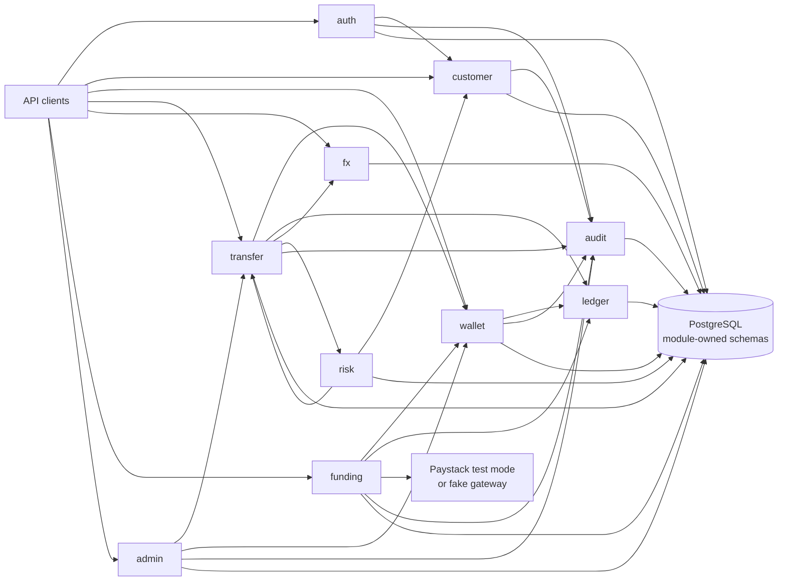

# Cross-Border Wallet

A Java 21 and Spring Boot modular monolith for NGN and XAF wallets, transfers, FX conversion, risk review, and sandbox funding. PostgreSQL is the persistence store, Flyway owns schema changes, and ArchUnit checks package-level module boundaries.

## Architecture



Modules are package-separated under `com.example.crossborder`. Each module owns its repositories and tables. Cross-module collaboration uses public types in the provider module's `api` package or application events; modules must not access another module's domain, application, or infrastructure packages. `ModuleBoundaryTest` enforces the internal-package restriction.

## Modules

| Module | Responsibilities |
| --- | --- |
| `auth` | Registration, login, BCrypt credentials, JWT access tokens, rotating refresh tokens, logout, and USER/ADMIN roles. |
| `customer` | Customer profile, `en`/`fr` preference, and KYC status. Missing profiles are treated as `PENDING` by risk evaluation. |
| `wallet` | One wallet per customer and currency, status controls, deterministic wallet row locking, and the cached ledger-balance projection. |
| `ledger` | Immutable double-entry entries and transactions, integer minor-unit storage, transaction balance checks, and ledger-derived balances. |
| `transfer` | Wallet transfers and conversions, idempotency, state transitions, wallet locking, and transfer review contracts. |
| `fx` | Persisted rate snapshots, 60-second quotes, configurable mock rate/spread/fees, and FX clearing/fee ledger accounts. |
| `risk` | Configurable transfer amount, velocity, KYC, and daily outgoing rules; stores each assessment. |
| `admin` | Flagged-transfer approval/rejection, wallet freeze/unfreeze, and audit-log browsing. Admin role provisioning is an operational responsibility, not a public registration option. |
| `funding` | Payment intents, Paystack test-mode and fake gateway adapters, signed webhook validation, and gateway-reference idempotency. |
| `audit` | Append-only records of sensitive actions and a bounded read interface for administrators. |

Database schemas are owned by their modules: `auth`, `customer`, `wallet`, `ledger`, `transfer`, `fx`, `risk`, `admin`, `audit`, and `funding`. Migrations are in `src/main/resources/db/migration`; Hibernate schema generation is not used. Flyway's history table is kept in `public`.

## Requirements

- Java 21 and Maven 3.9+.
- Docker with Docker Compose for the app/database stack and Testcontainers integration tests.
- PostgreSQL 17 is used by Compose and integration tests.

This repository does not include the Maven wrapper; use `mvn` commands below.

## Run Locally

Start the application and PostgreSQL:

```bash
docker compose up --build
```

The API listens at `http://localhost:8080`. Flyway applies migrations on startup. OpenAPI UI is available at `http://localhost:8080/swagger-ui.html`.

For local development without Docker Compose, start PostgreSQL and run:

```bash
mvn spring-boot:run
```

Default local database credentials are `wallet` / `wallet`; set `SPRING_DATASOURCE_URL`, `SPRING_DATASOURCE_USERNAME`, and `SPRING_DATASOURCE_PASSWORD` to override them. Compose credentials are development-only. Set a strong `JWT_SECRET` and `FUNDING_WEBHOOK_SECRET` outside local development.

The fake funding gateway is selected by default. To use the Paystack test adapter, set `FUNDING_GATEWAY=paystack`, `PAYSTACK_SECRET_KEY`, and `FUNDING_WEBHOOK_SECRET`. Do not use live payment credentials in this sandbox service.

## Test

Run all unit, architecture, and integration tests:

```bash
mvn test
```

Testcontainers starts PostgreSQL for integration tests, so Docker must be available. Tests can instead be pointed at a disposable PostgreSQL database with `TEST_DATABASE_URL`, `TEST_DATABASE_USERNAME`, and `TEST_DATABASE_PASSWORD`. Never point integration tests at a database containing data you need to keep.

The GitHub Actions workflow runs `mvn verify` on Java 21 with a PostgreSQL service.

## API Examples

Examples use `jq` to retain tokens and identifiers. Authenticated routes require `Authorization: Bearer <access-token>`. Access tokens are short-lived; use `/api/auth/refresh` to rotate the refresh token.

Register and capture the access token:

```bash
BASE=http://localhost:8080
REGISTER=$(curl -sS -X POST "$BASE/api/auth/register" \
  -H 'Content-Type: application/json' \
  -d '{"email":"sender@example.com","password":"strong-password-123","preferredLanguage":"en"}')
TOKEN=$(printf '%s' "$REGISTER" | jq -r .accessToken)
```

Create an NGN wallet and read the customer profile:

```bash
SOURCE_WALLET=$(curl -sS -X POST "$BASE/api/wallets" \
  -H "Authorization: Bearer $TOKEN" -H 'Content-Type: application/json' \
  -d '{"currency":"NGN"}')
curl -sS "$BASE/api/customers/me" -H "Authorization: Bearer $TOKEN"
```

Create a second user and wallet for the recipient, then create a wallet transfer. Every transfer/conversion POST requires a fresh `Idempotency-Key`. The sender wallet must be funded first.

```bash
RECIPIENT_REGISTER=$(curl -sS -X POST "$BASE/api/auth/register" \
  -H 'Content-Type: application/json' \
  -d '{"email":"recipient@example.com","password":"strong-password-456","preferredLanguage":"fr"}')
RECIPIENT_TOKEN=$(printf '%s' "$RECIPIENT_REGISTER" | jq -r .accessToken)
DEST_WALLET=$(curl -sS -X POST "$BASE/api/wallets" \
  -H "Authorization: Bearer $RECIPIENT_TOKEN" -H 'Content-Type: application/json' \
  -d '{"currency":"NGN"}')

curl -sS -X POST "$BASE/api/transfers" \
  -H "Authorization: Bearer $TOKEN" \
  -H 'Idempotency-Key: transfer-2026-0001' \
  -H 'Content-Type: application/json' \
  -d "{\"sourceWalletId\":\"$(printf '%s' "$SOURCE_WALLET" | jq -r .id)\",\"destinationWalletId\":\"$(printf '%s' "$DEST_WALLET" | jq -r .id)\",\"amount\":\"2500.00\"}"
```

Request and consume a 60-second FX quote:

```bash
QUOTE=$(curl -sS -X POST "$BASE/api/fx/quotes" \
  -H "Authorization: Bearer $TOKEN" -H 'Content-Type: application/json' \
  -d '{"sourceCurrency":"NGN","destinationCurrency":"XAF","sourceAmount":"10000.00"}')

# Create an XAF wallet for the recipient before converting.
DEST_XAF=$(curl -sS -X POST "$BASE/api/wallets" \
  -H "Authorization: Bearer $RECIPIENT_TOKEN" -H 'Content-Type: application/json' \
  -d '{"currency":"XAF"}')

curl -sS -X POST "$BASE/api/transfers/convert" \
  -H "Authorization: Bearer $TOKEN" \
  -H 'Idempotency-Key: conversion-2026-0001' \
  -H 'Content-Type: application/json' \
  -d "{\"sourceWalletId\":\"$(printf '%s' "$SOURCE_WALLET" | jq -r .id)\",\"destinationWalletId\":\"$(printf '%s' "$DEST_XAF" | jq -r .id)\",\"quoteId\":\"$(printf '%s' "$QUOTE" | jq -r .id)\"}"
```

Create a sandbox funding intent:

```bash
PAYMENT=$(curl -sS -X POST "$BASE/api/funding/payments" \
  -H "Authorization: Bearer $TOKEN" -H 'Content-Type: application/json' \
  -d "{\"walletId\":\"$(printf '%s' "$SOURCE_WALLET" | jq -r .id)\",\"amount\":\"5000.00\",\"currency\":\"NGN\",\"email\":\"sender@example.com\"}")
printf '%s\n' "$PAYMENT"
```

For local fake-gateway testing, sign the exact webhook body with the configured webhook secret. Paystack sends the same HMAC-SHA512 signature in `x-paystack-signature`:

```bash
REFERENCE=$(printf '%s' "$PAYMENT" | jq -r .reference)
BODY=$(printf '{"event":"charge.success","data":{"reference":"%s","amount":500000,"currency":"NGN"}}' "$REFERENCE")
SIGNATURE=$(printf '%s' "$BODY" | openssl dgst -sha512 -hmac "${FUNDING_WEBHOOK_SECRET:-local-funding-webhook-secret}" | awk '{print $2}')
curl -sS -X POST "$BASE/api/funding/webhooks/paystack" \
  -H "x-paystack-signature: $SIGNATURE" -H 'Content-Type: application/json' \
  --data-binary "$BODY"
```

Admin routes under `/api/admin/**` require an ADMIN token. The application intentionally does not expose public role elevation. Provision the first administrator through a controlled operational process, then use the flagged-transfer, wallet freeze/unfreeze, and audit endpoints:

```bash
ADMIN_TOKEN='<access token for a provisioned ADMIN>'
curl -sS "$BASE/api/admin/transfers/flagged" -H "Authorization: Bearer $ADMIN_TOKEN"
curl -sS -X POST "$BASE/api/admin/transfers/<transfer-id>/approve" \
  -H "Authorization: Bearer $ADMIN_TOKEN"
curl -sS -X POST "$BASE/api/admin/wallets/<wallet-id>/freeze" \
  -H "Authorization: Bearer $ADMIN_TOKEN"
curl -sS "$BASE/api/admin/audit?limit=100" -H "Authorization: Bearer $ADMIN_TOKEN"
```

Errors use `application/problem+json` (RFC 7807). Messages support French and English using `Accept-Language: fr` or `Accept-Language: en`.

## Design Decisions

### Double-entry ledger

The ledger is the balance source of truth. Each movement posts equal debits and credits in the same currency and database transaction. Ledger transactions and entries are append-only, with database checks for balanced postings. Wallet balances are a transactional projection used for quick reads and checked against ledger-derived amounts in integration tests. NGN values are stored in kobo and XAF values in whole units; Java amounts use `BigDecimal` and never floating point.

### Idempotency and concurrency

Money-moving endpoints require an `Idempotency-Key`. The request hash distinguishes safe retries from key reuse with a different payload; the original status and response body are replayed. Transfers lock wallet rows in ascending wallet-ID order with `SELECT ... FOR UPDATE`, which serializes competing debits and reduces deadlocks. Webhook settlement is independently idempotent on the unique gateway reference and payment-row lock.

### FX pricing and quote lifetime

Rates and the quote’s complete calculation snapshot are persisted. Quotes expire after 60 seconds and can be consumed once. NGN and XAF rounding follows each currency’s minor-unit rules. Flat-fee and spread revenue are posted to system fee ledger accounts; each currency leg balances independently through its clearing account.

### Risk and review

Risk checks run before ledger posting. Daily outgoing and unverified-KYC violations reject; high single amounts and velocity flags remain in `FLAGGED` without moving money. Admin approval rechecks wallet status and available ledger balance before posting. Wallet freeze and review decisions are audited.

### Modular monolith to services

The initial deployment keeps modules in one process and one PostgreSQL cluster, but module-owned schemas and public APIs define extraction boundaries. A future service split can move a module’s API behind HTTP/gRPC or publish its existing domain notifications through a broker. Ledger posting, idempotency, and webhook processing would then need durable outbox/inbox delivery, service authentication, and distributed operational monitoring; the current ACID transaction must not be replaced with fire-and-forget messaging.